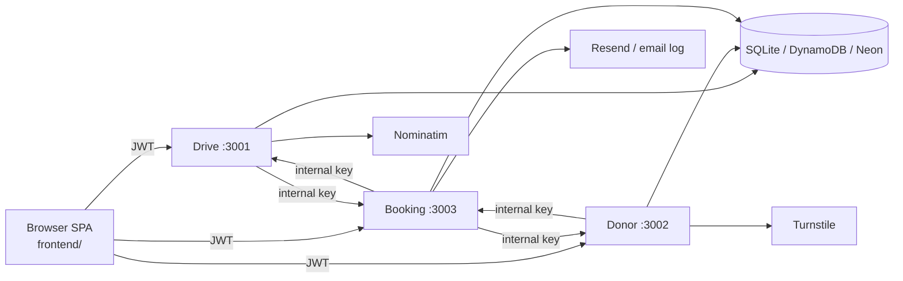

# Full Project Guide — Blood Donation Drive Organizer (BloodLink)

This guide explains **what was actually built**, how the code is organised, how to run and test it locally and in the cloud, how to demonstrate the complete journey, and where every piece of report evidence comes from. It is written from the source in `shared/`, `services/`, `frontend/` and `infra/`. Placeholders such as `<DEPLOYED_URL>` are not real URLs or credentials.

---

## 1. The problem and the product

Organisers of community blood drives need a simple way to publish drive dates and time slots, avoid overbooking, see who attended, and remind donors. Donors need to know whether they are eligible, find a nearby drive, reserve a seat and see their donation history. The class project builds one web application with three independently owned services:

| Service | Student | Core functions |
| --- | --- | --- |
| Drive Management | **Habiba** | Create/edit/cancel drives, manage slots with capacity, search by city/date/near-place, generate turnout report |
| Donor and Eligibility | **Tasneem** | Register/login, donor profile, eligibility rule (56-day default), donation history, account deletion |
| Booking and Reminder | **Hala** | Book a slot, cancel and release seat, check-in attended/no-show, confirmation/cancellation/reminder emails |

**In scope:** browser SPA, three JSON APIs, shared auth with JWT, internal service-to-service calls, Nominatim geocoding, Turnstile bot check, Resend email (Brevo fallback), SQLite/DynamoDB/Neon storage, Floci and Cloudflare deployment scripts.

**Out of scope:** clinical eligibility verification, payments, SMS, mobile app, blood-type matching, production-grade observability. See `docs/limitations.md`.

---

## 2. Architecture in one minute



* **Presentation:** static SPA with hash router (`frontend/js/app.js`) and a `fetch` wrapper (`frontend/js/api.js`).
* **Application:** three services sharing `shared/router.js`. Controllers receive `ctx` and return `{status, body}`. The same routes run on Express, Lambda and Workers.
* **Data:** nine logical tables (`bdo_drives`, `bdo_slots`, `bdo_reports`, `bdo_users`, `bdo_donors`, `bdo_donations`, `bdo_bookings`, `bdo_reminders`, `bdo_geocodes`) with one JSON document per row.
* **Cloud model:** serverless-first (Workers/Lambdas), managed Postgres (Neon), object storage (S3), IAM roles; Floci container only for local AWS practice.

Full diagrams and rationale: `docs/architecture.md`. Endpoints: `docs/api.md` and `docs/openapi.yaml`. Data: `docs/data-model.md`.

---

## 3. File structure

```text
.
├── package.json                  # npm workspaces + dev/test/seed/bundle scripts
├── FULL_PROJECT_GUIDE.md         # this guide
├── docs/
│   ├── architecture.md           # 3 layers, Mermaid, cloud rationale, request flow
│   ├── api.md                    # all 39 routes with auth, validation, statuses
│   ├── data-model.md             # 9 tables, ER diagram, CRUD/search, atomic seats
│   ├── deployment.md             # local, Floci, Cloudflare/Neon, secrets, evidence
│   ├── testing.md                # test IDs, expected/actual placeholders, evidence
│   ├── limitations.md            # honest limitations, reasons, improvements
│   ├── individual-statements.md  # 3 statements x 9 mandatory items
│   ├── notes.md                  # chronological difficulties and fixes
│   └── openapi.yaml              # validated OpenAPI 3.0 summary
├── frontend/
│   ├── index.html                # SPA shell, loads config.js then app.js
│   ├── wrangler.toml             # Cloudflare static assets, project bdo-organizer
│   ├── css/styles.css
│   └── js/
│       ├── config.js             # window.BDO service URLs (no secrets)
│       ├── api.js                # JWT/localStorage + fetch wrapper
│       ├── app.js                # hash routes, session restore, service health
│       ├── ui.js                 # escape, toast, modal, badges, nav
│       └── views/
│           ├── home.js           # landing page + live stats
│           ├── auth.js           # register/login + Turnstile widget
│           ├── drives.js         # search + drive detail + Book seat
│           ├── donor.js          # profile, eligibility banner, history, my bookings
│           └── organizer.js      # drive/slot/bookings/report/emails dashboard
├── shared/
│   ├── config.js                 # env or Worker env binding; all settings
│   ├── context.js                # injected store + clock
│   ├── crypto.js                 # PBKDF2, HMAC JWT, ids
│   ├── errors.js                 # HttpError + JSON error envelope
│   ├── http.js                   # ok/created/noContent, CORS/security headers
│   ├── router.js                 # route(), applyAuth(), workerFetch(), mountExpress()
│   ├── serviceClient.js          # internal HTTP calls with key + timeout
│   ├── validate.js               # field/id/date/time validators
│   ├── external/{geo,turnstile,email}.js
│   └── store/{index,tables,sqlite,dynamo,neon}.js
├── services/
│   ├── drive/                    # Habiba: app/server/worker/lambda, routes, controllers, rules, s3
│   ├── donor/                    # Tasneem: auth, donors, internal, eligibility, rate limit
│   └── booking/                  # Hala: bookings, reminders, internal, rules, notifications, templates
└── infra/
    ├── db/schema.sql             # nine Neon tables
    ├── floci/docker-compose.yml  # Floci emulator on :4566
    ├── config.sh, deploy-all.sh, check.sh, destroy.sh, gateway.sh, frontend.sh
    ├── services/{drive,donor,booking}.sh
    ├── iam/*.json                # Lambda trust + per-service policies
    ├── secrets.env.example       # never commit the real secrets.env
    └── scripts/{dev-all,seed,zip-lambda,bundle-workers}.js
```

Generated/ignored directories: `node_modules/`, `dist/`, `*.zip`, `.data/` (SQLite plus WAL/SHM files), `infra/.state`, `infra/secrets.env`, `.env`, `.dev.vars`.

---

## 4. How the code works

### 4.1 One controller, three runtimes

`shared/router.js` defines a route table. `mountExpress()` attaches it to Express for local and Lambda deployment; `workerFetch()` matches the same table for Cloudflare Workers. Both:

1. add CORS and security headers;
2. parse a JSON body up to 20 KB (`serverless-http` Buffer bodies are normalized in `shared/router.js` so Express 5 can parse them on Lambda);
3. check `Authorization: Bearer <JWT>` or `x-internal-key`;
4. call the controller with `ctx`;
5. serialise `{status, body}` or a translated error envelope.

`shared/context.js` holds the active store; `shared/config.js` reads `process.env` locally or Worker `env` bindings after `setEnv(env)`. This is why `services/drive/worker.js`, `lambda.js` and `server.js` can share `routes.js` and `controllers/drives.js` unchanged.

### 4.2 Main workflows

| Workflow | Steps |
| --- | --- |
| Publish a drive | Organizer JWT → `POST /api/drives` → Nominatim geocode (cached) → `bdo_drives` row → `POST .../slots` → `bdo_slots` rows |
| Book a seat | Donor JWT → `POST /api/bookings` → Drive internal GET → Donor internal eligibility → atomic seat reserve → `bdo_bookings` insert → confirmation email row |
| Cancel | `POST /api/bookings/:id/cancel` → CAS to `cancelled` → atomic seat release → cancellation email row |
| Check in | Organizer JWT → `PATCH /api/bookings/:id/check-in {outcome}` → (if attended) Donor `POST /internal/donations` → CAS booking to `attended`/`no_show` |
| Report | `GET /api/drives/:id/report` → Booking internal stats → rate calculation → `bdo_reports` row + optional S3 CSV |
| Reminders | Organizer button or internal daily route → `sendForDate()` → idempotent `bdo_reminders` rows → Resend (or Brevo fallback) or dev log |

All internal calls carry `x-internal-key` and are implemented in `shared/serviceClient.js` with a 10-second timeout.

### 4.3 Rules that matter

* Drive: title 3–120, venue 3–160, city 2–80, valid date; slots `HH:MM`, start < end, capacity 1–200, no overlap; only the creator may edit; only `scheduled` drives are editable.
* Eligibility: age 18–65, weight ≥ 50 kg, at least `DONATION_INTERVAL_DAYS` (default 56) since last donation, not before `deferredUntil`.
* Booking: drive must be scheduled and in the future, donor eligible on drive date, slot exists, one booking per donor per drive, seat count guarded atomically.
* Email: every attempt is stored in `bdo_reminders` with status `pending/sent/dev-log/failed`; a failure never breaks the booking response.

---

## 5. Run locally

```bash
npm install
npm run dev
```

Open **http://localhost:8090** (not 8080 — that port was occupied; see `docs/notes.md`). APIs: **3001 drive**, **3002 donor**, **3003 booking**. `TEST_MODE=1`, `EMAIL_MODE=log`, `DATA_DRIVER=sqlite` are injected automatically.

Optional seed:

```bash
npm run seed
```

It registers a demo organizer and donor through the real APIs, creates a drive three days in the future and two slots, and prints credentials, the drive id and `http://localhost:8090`. Its final message now points to 8090.

Quick health check:

```bash
curl -s http://localhost:3001/api/health/drive
curl -s http://localhost:3002/api/health/donor
curl -s http://localhost:3003/api/health/booking
```

Full API examples (register, create, book, check-in, report, reminders, invalid cases) are in `docs/api.md` section 6.

---

## 6. Test

```bash
npm test                    # node --test --test-concurrency=1
npm test -w @bdo/drive
npm test -w @bdo/donor
npm test -w @bdo/booking
```

`npm test` runs **59 tests, 59 pass, 0 fail**, across `tests/{booking-api,donor-api,drive-api,integration,pending-evidence,runtime-robustness,shared-rules}.test.js`. `docs/testing.md` keeps the DRV-01–13, DON-01–16, BOK-01–19 and E2E-01–06 case IDs; fill its Actual/Result columns only after capturing output.

Local smoke `scripts/smoke.mjs` reports **22 PASS**: register/login, drive and slot, eligibility, booking `201`, duplicate `409`, reminders (1 sent + 1 skipped), check-in `attended`, donation recorded, report `{booked:1,attended:1,turnout:100,storage:"database"}`, and 401/403/404/400/409 cases. It creates fresh accounts each run and supports `BDO_API_URL` for Floci. Floci smoke through the API Gateway also reports **22 PASS**, with report `storage:"s3"`. Booking ids use `driveId__donorId`; `idParam()` accepts them and cancel/check-in are verified.

Test hooks already in code: `TEST_MODE=1` (deterministic geocode, no Turnstile), `EMAIL_MODE=log` (no real sends), `setClock()` for time-dependent rules, `setServiceFetch()` to stub cross-service calls.

---

## 7. Deploy

### 7.1 Floci / AWS emulator

```bash
docker compose -f infra/floci/docker-compose.yml up -d
bash infra/deploy-all.sh
bash infra/check.sh
```

This creates one API Gateway, three Lambdas, all nine DynamoDB tables, an S3 website `bdo-web`, an S3 report bucket, three IAM roles, three CloudWatch log groups and an EventBridge reminder rule. `infra/.state` records `API_ID`/`API_URL`; `infra/secrets.env` is generated with random JWT/internal/invite values and must never be committed. The verified API Gateway is `http://079d67cedb.execute-api.localhost.floci.io:4566`; `bash infra/check.sh` ends with **ALL CHECKS PASSED** (drive/donor/booking health 200, drive list 200, website 200, Floci dashboard 200). Container/image/volume evidence is in `evidence/FLOCI-DOCKER.txt`.

Website: `<FLOCI_URL>/bdo-web/index.html` (normally `http://localhost:4566/bdo-web/index.html`).

Floci fixes now in place: relative `fileb://dist/lambda/<service>.zip` paths avoid Windows paths with spaces; Lambda `AWS_ENDPOINT_URL=http://floci:4566` uses Docker DNS; the S3 client uses `forcePathStyle` for emulator endpoints; DynamoDB `reserveSeat()` uses read-compare-update with retry; and `shared/router.js` normalizes `serverless-http` Buffer bodies so Express 5 parses JSON on Lambda.

### 7.2 Cloudflare Workers + Neon

```bash
# 1. apply schema
psql "<NEON_DATABASE_URL>" -f infra/db/schema.sql

# 2. bundle and deploy
npm run workers:bundle
npx wrangler deploy --config services/drive/wrangler.toml
npx wrangler deploy --config services/donor/wrangler.toml
npx wrangler deploy --config services/booking/wrangler.toml

# 3. set secrets on each service (examples)
npx wrangler secret put DATABASE_URL --config services/drive/wrangler.toml
npx wrangler secret put JWT_SECRET --config services/drive/wrangler.toml
npx wrangler secret put INTERNAL_KEY --config services/drive/wrangler.toml
npx wrangler secret put BOOKING_SERVICE_URL --config services/drive/wrangler.toml
# ...and the Donor/Resend/Turnstile secrets described in docs/deployment.md

# 4. edit frontend/js/config.js with the real Worker URLs, then:
npx wrangler deploy --config frontend/wrangler.toml
```

**Cloudflare status:** public deployment is live at **https://bdo-organizer.bdo-organizer.workers.dev** with the three Workers on the same `bdo-organizer.workers.dev` subdomain and the supplied Neon database. `infra/scripts/configure-cloudflare.js` and `npm run deploy:cloudflare` remain available for redeployment to a permanent account. All three `wrangler.toml` files use `compatibility_flags = ["global_fetch_strictly_public"]` so Worker-to-Worker calls work (error `1042` otherwise); service bindings (`env.BOOKING`, `env.DRIVE`, `env.DONOR`) are also configured to avoid preview-account `522` errors. Resend live email is enabled with `EMAIL_MODE=live`. The Booking Worker has `[triggers] crons = ["0 6 * * *"]` plus a `scheduled()` handler; the Booking Lambda handles EventBridge `aws.events` scheduled events. The account has been claimed; the trigger is declared in `services/booking/wrangler.toml`. The manual Reminder button and internal daily route were also verified. Evidence: `evidence/PUBLIC-DEPLOYMENT.txt`, `evidence/PUBLIC-SMOKE.txt`, `evidence/RESEND-LIVE-EMAIL.txt`, `evidence/PUBLIC-E2E-*.png`. Full checklist: `docs/deployment.md`.

---

## 8. Demo scenario (main end-to-end journey)

Run on the deployed URL for the video; the same steps work locally with the ports above. Use unique demo emails each run to avoid duplicate-account conflicts.

1. **Organizer signs up** — `#/register` → role Organizer → invite code `<ORGANIZER_INVITE>` → redirected to `#/organizer`. API: `POST /api/auth/register`.
2. **Create a drive** — Organizer → New drive → title, city, venue, date (future), description. API: `POST /api/drives`. Note the drive id.
3. **Add slots** — Slots tab → 09:00–11:00 capacity 10. API: `POST /api/drives/:id/slots`.
4. **Donor signs up in another browser profile** or logs out — `#/register` → role Donor → blood type O+, weight 68, birth year 1998. API: `POST /api/auth/register`.
5. **Check eligibility** — `#/profile` shows "You can donate today." API: `GET /api/donors/me/eligibility`.
6. **Find and book** — `#/drives`, search by city or `near` → open drive → Book seat → confirmation toast. API: `POST /api/bookings`. The Drive internal reservation increments `booked`; a confirmation row appears in `bdo_reminders`.
7. **Reminder** — Organizer → Emails tab → choose drive date → Send. API: `POST /api/reminders/send`. Run it twice to show `skipped` on the second run.
8. **Check in** — Organizer → Bookings tab → Attended. API: `PATCH /api/bookings/:id/check-in`. This calls Donor `POST /internal/donations`; the donor's history and next eligible date change.
9. **Report** — Organizer → Report tab → Generate. API: `GET /api/drives/:id/report` shows fill/turnout/no-show rates and snapshot location.
10. **Cancel path (separate demo booking)** — Donor → My bookings → Cancel → seat count returns to previous value. API: `POST /api/bookings/:id/cancel`.
11. **Drive cancellation path** — Organizer → Cancel drive → Booking cancellations + seat reset; then Delete becomes available when no bookings remain.

> Booking ids are `driveId__donorId` (double underscore). `idParam()` accepts this format, and both local and Floci smoke runs verify cancel/check-in with real ids.

Video guidance (≤5 minutes): show the public URL first, run steps 1–9 quickly, then short segments per student service. No commentary needed; link must be "anyone with the link can view".

---

## 9. Where report evidence comes from

| Report section | Evidence source |
| --- | --- |
| 1. Problem definition | This guide section 1 + `docs/limitations.md` scope list |
| 2. Architecture and cloud model | `docs/architecture.md` Mermaid diagrams + cloud model table; instructor Cloudflare/Neon approval screenshot |
| 3. Service/API list, ER diagram, CRUD | `docs/api.md` (all 39 routes), `docs/data-model.md` (ER + CRUD), `docs/openapi.yaml` |
| 4. Methodology / technical solution | This guide sections 2–4; file structure; shared runtime table |
| 5. External integration | `shared/external/*.js`; `docs/architecture.md` section 6; Turnstile widget in `auth.js`; `EMAIL_DEV_LOG` vs Resend response. Live Nominatim evidence is in `evidence/DRV-05-live-geocode.txt`; live Resend evidence in `evidence/RESEND-LIVE-EMAIL.txt`; `TEST_MODE` is used only in tests/smoke |
| 6. Deployment approach | `docs/deployment.md`; verified Floci `ALL CHECKS PASSED` at `http://079d67cedb.execute-api.localhost.floci.io:4566`; public Cloudflare + Neon URLs, health/CORS, config and Neon rows in `evidence/PUBLIC-DEPLOYMENT.txt`; public smoke in `evidence/PUBLIC-SMOKE.txt`; public browser in `evidence/PUBLIC-E2E-*.png` |
| 7. GitHub repository | `[REPO_URL]` + branches, `v1.0` and source ZIP exist; PR/review evidence — **not yet created** |
| 8. Demo video | `[VIDEO_URL]` recorded from **https://bdo-organizer.bdo-organizer.workers.dev** — **not yet created** |
| 9. Testing | `npm test` 59/59; local smoke 22/22; Floci smoke 22/22 (`storage:"s3"`); public Cloudflare/Neon smoke 22/22 (`storage:"database"`); `docs/testing.md` case IDs + captured `curl`/Postman responses, test-run screenshots, DB rows |
| 10. Limitations | `docs/limitations.md` with reason + improvement per item |
| Individual statements | `docs/individual-statements.md` — three statements, nine mandatory items each; replace all placeholders |

**Evidence capture rules:** never include a real secret or full JWT; redact after capturing status codes; name files by test ID; keep screenshots of 400/401/403/404/409/429/502 as well as success cases; make the zip and video from the same `v1.0` tag.

---

## 10. Current completion status

### Verified / done in this workspace

- [x] All three services with their controllers, business rules, internal endpoints and three runtime entry points.
- [x] SPA with all eight routes and screens for organizer, donor and booking workflows.
- [x] Shared router, store abstraction (SQLite/DynamoDB/Neon), crypto, validation, service client and external integrations.
- [x] Local one-command dev environment on ports 8090/3001/3002/3003 with WAL-protected SQLite; seed final message fixed to 8090.
- [x] Floci deployment completes: `ALL CHECKS PASSED` at `http://079d67cedb.execute-api.localhost.floci.io:4566`; 9 DynamoDB tables, 3 `bdo-*` Lambdas, `bdo-drive-reports` and `bdo-web` S3 buckets; drive/donor/booking health, drive list, website and Floci dashboard all return 200.
- [x] Floci fixes: relative `fileb://dist/lambda/<service>.zip` paths, Lambda `AWS_ENDPOINT_URL=http://floci:4566`, DynamoDB `reserveSeat()` read-compare-update with retry, S3 `forcePathStyle`, and `serverless-http` Buffer normalization in `shared/router.js`.
- [x] Booking ids use `driveId__donorId`; `idParam()` accepts them and cancel/check-in are verified locally and on Floci.
- [x] `npm test`: 59 tests, 59 pass, 0 fail across `tests/{booking-api,donor-api,drive-api,integration,pending-evidence,runtime-robustness,shared-rules}.test.js`.
- [x] Local smoke `scripts/smoke.mjs`: 22 PASS with fresh accounts each run and `BDO_API_URL` support; Floci smoke through the gateway: 22 PASS, report `storage:"s3"`.
- [x] Public Cloudflare Workers + Neon deployment is live at `https://bdo-organizer.bdo-organizer.workers.dev`; all three health endpoints 200 with correct CORS, deployed config points to the public Workers, and public smoke is 22/22 (`evidence/PUBLIC-DEPLOYMENT.txt`, `evidence/PUBLIC-SMOKE.txt`, `evidence/PUBLIC-E2E-*.png`). All three Workers set `global_fetch_strictly_public`; the Cron Trigger is declared in `services/booking/wrangler.toml`.
- [x] This documentation set (no source, package, infra, test or README file was modified).

### Still to do (unresolved, not claimed)

1. Create real per-student commits/PRs, protect `main`, recreate `v1.0` and the source ZIP from the final demonstrated commit, record the video, and store the repository/video links; CODEOWNERS stay placeholders until students' real GitHub usernames are known.
2. The Cloudflare preview account was claimed and the deployment was finalized on the permanent account; the public URLs below are final. No claim token is stored in the repository.
3. Capture the instructor Cloudflare/Neon approval screenshot; the public frontend browser screenshots are already in `evidence/PUBLIC-E2E-*.png`.
4. Optionally obtain real Turnstile test keys; Resend live email is already configured and evidenced in `evidence/RESEND-LIVE-EMAIL.txt`.
5. Capture manual Nominatim/geocode evidence (tests and smoke use `TEST_MODE` deterministic coordinates) and fill `docs/testing.md` Actual/Result columns with captured output.
6. Wake Neon before the demo, verify `3/3 services online`, and record the ≤5-minute video from the public URL.
7. Keep the remaining design limitations honest: saga window, read-then-write updates, in-memory rate limit, no pagination/indexes, PII in docs, JWT revocation, unused `REMINDER_DAYS_AHEAD`, and `/api/bookings/mine` not role-restricted.
