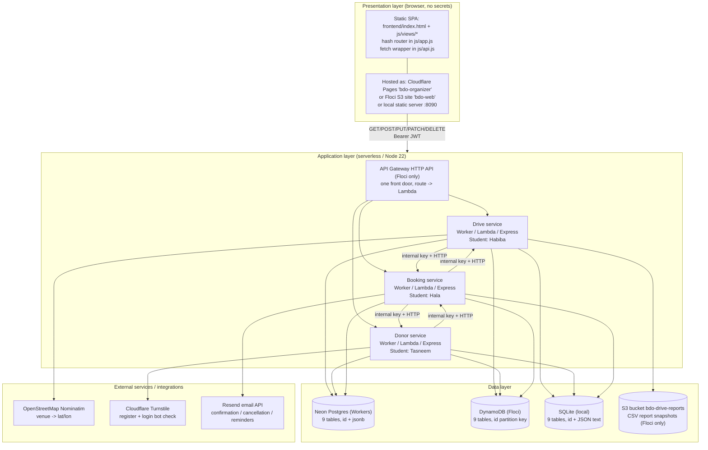

# Architecture

## 1. Purpose and scope

The Blood Donation Drive Organizer ("BloodLink" in the UI) is a three-service web application for a small class project team. An organizer publishes donation drives and time slots, a donor checks eligibility and reserves a seat, and the booking service coordinates both services and sends confirmation/reminder email records.

The system deliberately uses **one controller set per service that runs unchanged in three environments**:

| Environment | Presentation | Application | Data | Purpose |
| --- | --- | --- | --- | --- |
| Local development | Static SPA on `http://localhost:8090` | Three Express processes on ports `3001`, `3002`, `3003` | One shared SQLite file `.data/bdo.sqlite` | Fast iteration; no cloud account needed |
| Floci / AWS emulator | Static site in bucket `bdo-web` | Three Lambda functions behind one API Gateway HTTP API (verified: `http://079d67cedb.execute-api.localhost.floci.io:4566`) | 9 DynamoDB tables + S3 report bucket + CloudWatch Logs | Lab-style AWS evidence on a local emulator |
| Cloudflare + Neon (public deployment) | Cloudflare Workers static-asset site `bdo-organizer` | Three Cloudflare Workers `bdo-drive`, `bdo-donor`, `bdo-booking` | Neon Postgres tables (`id text`, `data jsonb`) | Public HTTPS URL without a payment card |

> **Status note:** the Cloudflare/Neon path is the **live public deployment** at **https://bdo-organizer.sumptuous-william.workers.dev**. The Worker entry points, `wrangler.toml` files and `infra/db/schema.sql` are deployed; all three Workers set `global_fetch_strictly_public`, and cross-service calls use Cloudflare service bindings (`env.BOOKING`, `env.DRIVE`, `env.DONOR`) instead of public `workers.dev` fetches. The Booking Worker has `[triggers] crons = ["0 6 * * *"]` and a `scheduled()` handler, and the Booking Lambda handles EventBridge `aws.events`. The temporary preview account allows 0 cron triggers, so the manual reminder route was verified instead. Resend live email is enabled. Evidence: `evidence/PUBLIC-DEPLOYMENT.txt`, `evidence/PUBLIC-SMOKE.txt` and `evidence/RESEND-LIVE-EMAIL.txt`. See `docs/deployment.md`.

## 2. Three-layer view



### Layer responsibilities

| Layer | Code | Responsibility |
| --- | --- | --- |
| Presentation | `frontend/index.html`, `frontend/css/styles.css`, `frontend/js/{app,api,ui}.js`, `frontend/js/views/*.js` | Render screens, keep the JWT in `localStorage`, call service APIs, show errors/toasts. No business rules and no secrets. |
| Application | `services/{drive,donor,booking}/routes.js`, `controllers/*`, `services/*`, `shared/router.js` | Route matching, JWT/internal-key checks, validation, business rules, cross-service calls, email/geo integration. Controllers return `{ status, body }`; they never touch `req`/`res`. |
| Data | `shared/store/{index,sqlite,dynamo,neon,tables}.js`, `infra/db/schema.sql` | Uniform `get/put/insert/update/cas/remove/all/search/reserveSeat` interface. Selected by `DATA_DRIVER` on Node, imported directly in Workers. |

`shared/context.js` injects the active store and clock. `shared/config.js` reads values from `process.env` locally or from the Worker `env` binding via `setEnv(env)`. This is why the same controller files run on all three targets.

## 3. Cloud model and rationale

**Chosen approach: serverless-first, with managed data services; containers only as a local AWS emulator.**

| Choice | Evidence in repository | Why it fits |
| --- | --- | --- |
| Serverless functions | Cloudflare Workers (`services/*/worker.js`) and AWS Lambda (`services/*/lambda.js`, 20 s timeout) | Three small HTTP services with bursty class-demo traffic; no server to patch; scales to zero; free tiers suit a student budget. |
| Managed Postgres as a service | `@neondatabase/serverless` and `infra/db/schema.sql` | HTTP query API works from Workers without a TCP pool; branching is useful for development; the JSONB document shape keeps three service schemas independent. |
| Object storage as a service | Floci S3 `bdo-web` (site) and `bdo-drive-reports` (CSV snapshots), `services/drive/services/s3.js` | Static frontend and generated artefacts do not belong in compute or the database. |
| Platform service for identity/security | Cloudflare Turnstile, WebCrypto PBKDF2 + HMAC JWT in `shared/crypto.js`, IAM roles in `infra/iam/*.json` | Bot protection and least-privilege access without running our own auth servers. |
| Containers (local only) | `infra/floci/docker-compose.yml` runs `floci/floci:latest` on port `4566` | Gives the team AWS-shaped deployment practice (DynamoDB, Lambda, API Gateway, S3, IAM, CloudWatch, EventBridge) without real cloud charges. |

The application is **not** a monolith: each student owns one deployable service and its logical tables, but all three share the request/response and storage abstractions in `shared/`.

## 4. Request flow

### 4.1 Browser read (no token required)

1. Browser loads the SPA. `frontend/js/app.js` restores any session via `GET /api/auth/me`.
2. `frontend/js/api.js` chooses a base URL from `window.BDO.services` and attaches `Authorization: Bearer <jwt>` when a token exists.
3. `shared/router.js` matches the route, adds CORS/security headers, applies auth/internal rules, calls the controller and serialises `{ status, body }`.
4. The controller reads through the injected store (SQLite / DynamoDB / Neon) and returns a DTO; the view renders it.

`shared/router.js` also normalizes `serverless-http` Buffer bodies so Express 5 parses JSON on Lambda.

### 4.2 End-to-end booking (the main integrated workflow)

```mermaid
sequenceDiagram
  participant D as Donor browser
  participant B as Booking service
  participant V as Drive service
  participant N as Donor service
  participant E as Resend / email log
  participant DB as Data layer

  D->>V: GET /api/drives/:id (slots + available counts)
  D->>B: POST /api/bookings {driveId, slotId} + JWT
  B->>V: GET /internal/drives/:id (x-internal-key)
  B->>N: GET /internal/donors/:id/eligibility?date=drive.date
  Note over B: assertBookable: scheduled, future date, eligible
  B->>V: POST /internal/drives/:id/slots/:slotId/reservation
  Note over V: atomic reserveSeat(+1); 409 if full
  B->>DB: insert bdo_bookings (id = driveId__donorId)
  B->>E: confirmation email (or dev-log record)
  E-->>DB: bdo_reminders row with status
  B-->>D: 201 {booking}
  D->>B: GET /api/bookings/mine
```

Cancellation reverses the flow with `DELETE .../reservation` (atomic `-1`) and a cancellation email. Organizer check-in calls `POST /internal/donations` on the Donor service before setting the booking to `attended`, so the donor's donation history and next eligible date are updated. The Drive report calls `GET /internal/drives/:id/stats` on Booking to compute fill/turnout/no-show rates.

All server-to-server calls use `shared/serviceClient.js`: a 10 s timeout, `x-internal-key` header, JSON body, and propagation of upstream error status/code. The router rejects a missing or wrong internal key with `401`.

## 5. Deployment mapping

| Component | Local | Floci / AWS emulator | Cloudflare + Neon |
| --- | --- | --- | --- |
| Website | `node infra/scripts/dev-all.js` static server, `:8090` | `infra/frontend.sh` → `s3://bdo-web/index.html`, URL `<FLOCI_URL>/bdo-web/index.html` | `frontend/wrangler.toml` → Pages project `bdo-organizer`; `js/config.js` generated by `infra/scripts/configure-cloudflare.js` |
| Drive API | `services/drive/server.js`, `:3001` | Lambda `bdo-drive-service`, routes in `infra/gateway.sh` | Worker `bdo-drive`, `main = dist/worker.js` |
| Donor API | `services/donor/server.js`, `:3002` | Lambda `bdo-donor-service` | Worker `bdo-donor` |
| Booking API | `services/booking/server.js`, `:3003` | Lambda `bdo-booking-service` | Worker `bdo-booking` |
| Drive data | SQLite `bdo_drives`, `bdo_slots`, `bdo_reports`, `bdo_geocodes` | DynamoDB same names; S3 `bdo-drive-reports` for reports | Neon tables from `infra/db/schema.sql` |
| Donor data | SQLite `bdo_users`, `bdo_donors`, `bdo_donations` | DynamoDB same names | Neon tables |
| Booking data | SQLite `bdo_bookings`, `bdo_reminders` | DynamoDB same names; EventBridge rule `bdo-daily-reminders` + `aws.events` branch in `lambda.js` | Neon tables; Cron Trigger `0 6 * * *` + `scheduled()` in `worker.js` |
| Cross-service base URLs | `http://localhost:300x` | `$API_URL` from `infra/.state` via API Gateway | Worker service bindings (`BOOKING`, `DRIVE`, `DONOR`); public Worker URLs remain as fallback vars/secrets |
| Secrets | environment variables / `.env` (git-ignored) | generated `infra/secrets.env`, Lambda environment variables / Turnstile & Resend env vars | `wrangler secret put` or `--secrets-file` (never in `wrangler.toml`) |

## 6. External services

| Integration | Where used | Configuration | Failure behaviour |
| --- | --- | --- | --- |
| OpenStreetMap Nominatim | `shared/external/geo.js`, called by Drive create/update and `?near=` search | No key; User-Agent header; results cached in `bdo_geocodes` | Geocoding failure is logged and returns `null`; create still succeeds with `lat/lon = null`; `?near=` returns `502` |
| Cloudflare Turnstile | `shared/external/turnstile.js`, called by Donor register/login; widget in `frontend/js/views/auth.js` | `TURNSTILE_SECRET` server-side, `TURNSTILE_SITE_KEY` client-side | Without a secret the service returns `{mode:'development'}`; with a secret, missing token → `401`, upstream failure → `502` |
| Resend (Brevo fallback) | `shared/external/email.js`, used by Booking confirmation, cancellation and reminders | `RESEND_API_KEY`, `EMAIL_FROM`, `EMAIL_MODE`; Brevo is used only when no Resend key is set (`BREVO_API_KEY`) | In `TEST_MODE`, `EMAIL_MODE=log`, or without a key, logs `EMAIL_DEV_LOG` and stores a `dev-log` row; real failures are stored as `failed` and never crash the bookings flow |

Live Nominatim evidence **is** captured in `evidence/DRV-05-live-geocode.txt` (drive creation with real coordinates, cached rows and `?near=` result); live Resend evidence is in `evidence/RESEND-LIVE-EMAIL.txt`; `TEST_MODE` is used only in automated tests and smoke runs.

All credentials are environment variables / Worker secrets. No real URL, key or token is stored in the repository.
