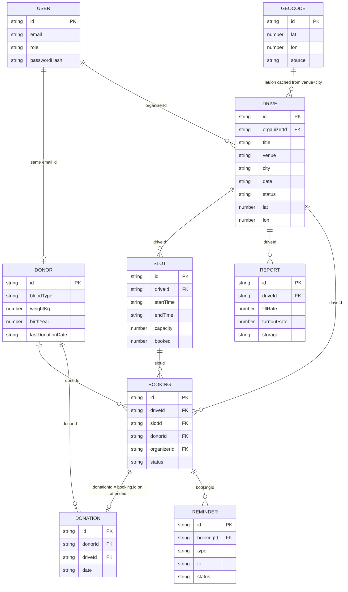

# Data model

## 1. Storage shape

`infra/db/schema.sql` (Neon) and `shared/store/tables.js` (logical table whitelist) define the same nine tables:

| Table | Owner service | Neon / SQLite DDL | DynamoDB (Floci) | Records created by |
| --- | --- | --- | --- | --- |
| `bdo_drives` | Drive | `(id text PRIMARY KEY, data jsonb NOT NULL)` / `(id TEXT PRIMARY KEY, data TEXT NOT NULL)` | `id` string partition key, PAY_PER_REQUEST | `createDrive` |
| `bdo_slots` | Drive | same | same | `createSlot` |
| `bdo_reports` | Drive | same | same | `getReport` |
| `bdo_users` | Donor | same | same | `register` |
| `bdo_donors` | Donor | same | same | `register` |
| `bdo_donations` | Donor | same | same | `recordDonation` (called at check-in) |
| `bdo_bookings` | Booking | same | same | `createBooking` |
| `bdo_reminders` | Booking | same | same | `notify` / `sendForDate` |
| `bdo_geocodes` | Drive (shared cache) | same | created by `infra/services/drive.sh` (all 9 Floci tables verified) | `geocode()` |

Every row is **one JSON document**. There are no SQL foreign keys, no secondary indexes and no migrations beyond `CREATE TABLE IF NOT EXISTS`; relationships are enforced in application code (`*Rules.js` and controllers) and by deterministic id conventions.

> **Floci status:** `infra/services/drive.sh` creates `bdo_geocodes` with the other Drive tables; the verified deployment has all 9 DynamoDB tables. Manual Nominatim evidence is not captured, and `TEST_MODE` uses deterministic coordinates in tests and smoke runs.

## 2. Entities and fields

Fields below are taken from the object literals in the controllers. `updatedAt` is added automatically by every store's `update()`.

| Entity | Key | Fields |
| --- | --- | --- |
| **Drive** | `id = drv_<uuid>` | `title`, `venue`, `city`, `date` (`YYYY-MM-DD`), `description`, `organizerId` (= user email), `organizerName`, `status` (`scheduled`/`cancelled`/`completed`), `lat`, `lon`, `locationLabel`, `createdAt`, `statusChangedAt` (after status change) |
| **Slot** | `id = slt_<uuid>` | `driveId`, `startTime` (`HH:MM`), `endTime`, `capacity` (1–200), `booked` (0–capacity), `createdAt`; computed on read: `available = max(0, capacity - booked)` |
| **Report** | `id = rpt_<uuid>` | `driveId`, `driveTitle`, `date`, `slots`, `capacity`, `booked`, `attended`, `noShow`, `cancelled`, `fillRate`, `turnoutRate`, `noShowRate`, `generatedAt`, `storage` (`database`/`s3`), `location` (`report:<id>` or `s3://…/…csv`) |
| **User** | `id = email` (lower-cased) | `email`, `name`, `role` (`donor`/`organizer`), `passwordHash` (`pbkdf2$60000$<salt>$<hash>`), `createdAt` |
| **Donor** | `id = userId = email` | `name`, `email`, `bloodType`, `weightKg`, `birthYear`, `phone?`, `lastDonationDate` (null initially), `deferredUntil` (null initially), `createdAt`; derived on read: `eligibility` |
| **Donation** | `id = don_<uuid>` or **`booking.id` on check-in** | `donorId`, `driveId`, `date`, `recordedAt` |
| **Booking** | `id = "<driveId>__<donorId>"` | `driveId`, `slotId`, `donorId`, `organizerId`, `driveTitle`, `driveDate`, `startTime`, `endTime`, `venue`, `donorName`, `donorEmail`, `bloodType`, `status` (`confirmed`/`cancelled`/`attended`/`no_show`), `createdAt`, `cancelledAt`, `cancellationReason?`, `checkedInAt?` |
| **Reminder / email log** | `id = "<bookingId>#<type>#<newId('mail')>"` for confirmation/cancellation; `"<bookingId>#reminder#<date>"` for the deduplicated daily reminder | `bookingId`, `donorId`, `driveId`, `organizerId`, `type`, `to`, `subject`, `scheduledFor`, `status` (`pending`/`sent`/`dev-log`/`failed`), `provider`, `messageId`, `sentAt`, `error?` |
| **Geocode cache** | `id = lowercased place with non-alphanumerics → '_'`, max 100 chars | `lat`, `lon`, `label`, `source` (`nominatim`/`test`), `fetchedAt` |

### Shared key style

* Email addresses are used directly as **user and donor ids** (`bdo_users`, `bdo_donors`). This makes JWT `id`, donor lookups and cross-service calls consistent, and avoids a separate id mapping table.
* A booking id is the deterministic composite `driveId__donorId`. It enforces **one booking per donor per drive** at the storage level and makes repeated booking attempts hit the same row. The double-underscore separator is accepted by `idParam()` in `shared/validate.js`, so cancel and check-in work end to end.
* A donation recorded by check-in reuses the booking id, giving an idempotent donation write (`200 {duplicate:true}` when the id already exists).
* A reminder id embeds the booking id, type and (for daily reminders) date, so repeated cron/button runs skip already-attempted sends.

## 3. Relationships (ER diagram)



Mermaid `||--o|` means zero-or-one; the diagram documents application-level relationships, not database constraints.

## 4. Store operations available to every service

`shared/store/index.js` selects the implementation. All three drivers expose the same methods:

| Method | Meaning | SQLite | DynamoDB | Neon |
| --- | --- | --- | --- | --- |
| `get(table,id)` | Read one document by primary key | prepared `SELECT` | `GetCommand` | `SELECT ... WHERE id=$1` |
| `put(table,record)` | Upsert | `ON CONFLICT DO UPDATE` | `PutCommand` | `ON CONFLICT DO UPDATE` |
| `insert(table,record)` | Create only if absent; returns `null` on conflict | `DO NOTHING`, checks `changes` | `ConditionExpression: attribute_not_exists(id)` | `DO NOTHING RETURNING data` |
| `update(table,id,patch)` | Merge patch, add `updatedAt` | read + `put` | read + `put` | `data || patch` |
| `cas(table,id,patch,expected)` | Conditional update; returns `null` if expected fields differ | read + compare + `put` | `UpdateCommand` + `ConditionExpression` | `UPDATE ... WHERE data->>'field' = $n` |
| `remove(table,id)` | Delete; returns old record | `DELETE` + `changes` | `DeleteCommand ALL_OLD` | `DELETE ... RETURNING data` |
| `all(table)` | Scan table | `SELECT data` | paginated `ScanCommand` | `SELECT data` |
| `search(table,field,value)` | Equality filter on a JSON field | `json_extract(data,'$.field') = ?` | `Scan` + JS filter | `data->>'field' = $1` |
| `reserveSeat(slotKey,delta)` | Guarded seat change (see below) | `UPDATE ... json_set ... WHERE booked+delta BETWEEN 0 AND capacity RETURNING data` | read current `booked`/`capacity`, then conditional `UpdateCommand` only if `booked` is unchanged; retry up to 5 times on conflict | `jsonb_set` with the same `BETWEEN` guard |

`assertTable()` from `tables.js` rejects any table name outside the nine whitelisted names; SQLite and Neon additionally validate the search field name with `/^[A-Za-z0-9_]+$/`.

## 5. CRUD and search by service

| Service | Create | Read | Update | Delete | Search / list | Business use of data |
| --- | --- | --- | --- | --- | --- | --- |
| **Drive (Habiba)** | `put` drive, `put` slot, `put` report | `get` drive/slot, `all` drives for list | `update` drive/status/slot, `reserveSeat(+1/-1)` | `remove` drive/slots/reports | `all('bdo_drives')` + in-memory `filterDrives` (city substring, status, date range), Nominatim `?near=` + haversine `filterNear`, `search('bdo_slots','driveId')`, `search('bdo_reports','driveId')`, `get('bdo_geocodes')` cache | Owner checks, status transitions, overlap checks, turnout report from Booking stats, CSV snapshot to S3 |
| **Donor (Tasneem)** | `insert` user/donor, `insert` donation | `get` user/donor/donation | `update` donor profile, `update` `lastDonationDate` | `remove` donation/donor/user on account deletion | `search('bdo_donations','donorId')` sorted by date | PBKDF2 hash, JWT issue, eligibility calculation (age, weight, 56-day interval, deferral), rate limit, Turnstile |
| **Booking (Hala)** | `insert` booking, `put`/`update` reminder rows | `get` booking/reminder | `cas` booking status for cancel/check-in, `update` reminder status | none (bookings are cancelled; reminders are retained as an audit log) | `search('bdo_bookings','donorId')`, `search('bdo_bookings','driveId')`, `all('bdo_bookings')` for stats/reminders, `all('bdo_reminders')` for organizer log | Eligibility + seat checks before insert, compensating seat release, donation recording on attended check-in, idempotent reminder ids, email status log |

## 6. Atomic seat update (never overbook)

The critical write guards the slot row. SQLite and Neon use a **single conditional UPDATE**; DynamoDB uses **read-compare-update with retry** because arithmetic is invalid in a `ConditionExpression`:

```sql
-- SQLite (shared/store/sqlite.js)
UPDATE bdo_slots
SET data = json_set(data, '$.booked', json_extract(data, '$.booked') + ?)
WHERE id = ? AND json_extract(data, '$.booked') + ? BETWEEN 0 AND json_extract(data, '$.capacity')
RETURNING data
```

```js
// DynamoDB (shared/store/dynamo.js)
// Read the current count, check capacity locally, then write only if unchanged.
// A competing writer fails the condition and is retried with the new value.
for (let attempt = 0; attempt < 5; attempt += 1) {
  const current = await get('bdo_slots', String(slotKey));
  if (!current) return null;
  const expected = Number(current.booked) || 0;
  const next = expected + delta;
  if (next < 0 || next > (Number(current.capacity) || 0)) return null;
  try {
    const result = await db.send(new UpdateCommand({
      TableName: 'bdo_slots',
      Key: { id: String(slotKey) },
      UpdateExpression: 'SET booked = :next',
      ConditionExpression: 'attribute_exists(id) AND (attribute_not_exists(booked) OR booked = :expected)',
      ExpressionAttributeValues: { ':next': next, ':expected': expected },
      ReturnValues: 'ALL_NEW'
    }));
    return result.Attributes || null;
  } catch (error) {
    if (isConditionalFailure(error)) continue;
    throw error;
  }
}
```

```sql
-- Neon (shared/store/neon.js)
UPDATE bdo_slots
SET data = jsonb_set(data, '{booked}', to_jsonb((data->>'booked')::integer + $1))
WHERE id = $2
  AND (data->>'booked')::integer + $1 BETWEEN 0 AND (data->>'capacity')::integer
RETURNING data
```

If the guard fails, the driver returns `null` and `reserveSeat()` in the Drive controller throws `409 'This slot is full'` (or `409 'Seat count cannot go below zero'` for release). Booking reserves the seat before inserting its booking row and, if the insert throws, calls the release endpoint in a compensating step. This is a saga-style compensation rather than a distributed transaction; a crash between the two calls can leave an extra reserved seat until the drive is cancelled (which resets slot `booked` to 0). See `docs/limitations.md`.

## 7. Notes on consistency and performance

* `get + put` in SQLite/DynamoDB `update()` is not atomic; `cas()` and the guarded seat updates are. DynamoDB `reserveSeat()` uses a local read/compare plus a conditional write with retry. Booking state transitions and seats use the guarded variants; drive metadata updates use the simple variant.
* DynamoDB `search()` is a full `Scan` with a JavaScript filter; Neon and SQLite use JSON equality predicates. This is acceptable for class-sized data but will not scale to large tables (improvement: GSI/columnar indexes).
* Cancelling a drive calls Booking once and then resets slots locally; per-booking seat releases are also attempted by Booking. The reset makes the final slot counts consistent even if some release calls fail.
* All timestamps come from `shared/context.js` (`now()`), which can be replaced in tests with `setClock()` for deterministic output.
