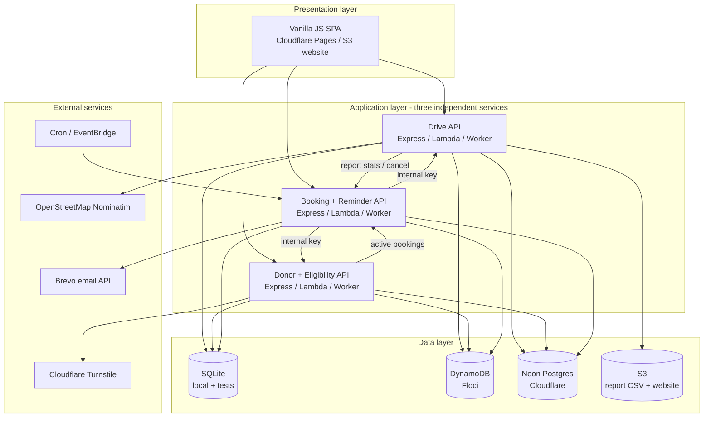
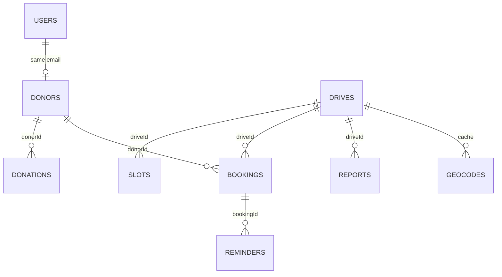

# Final Report — Blood Donation Drive Organizer (BloodLink)

**Status of this draft.** Sections 1–6, 9 and 10 describe code and results that are verified in this workspace on 25 Nov 2026. Sections 7–8 and the browser/public-cloud rows in section 9 cannot be completed from this workspace alone: they require the team's GitHub repository, the public Cloudflare/Neon credentials and a recorded video. Those items are marked **PENDING** rather than claimed. The three mandatory individual statements are in [`docs/individual-statements.md`](individual-statements.md).

---

## 1. Problem definition

Blood drives are usually coordinated with spreadsheets and informal messages. Organizers cannot see real-time seat availability, donors have no reliable way to check whether they are eligible on a given date, and confirmation/reminder emails are sent manually. Duplicate bookings, overbooked slots and missed eligibility windows are common.

BloodLink is a web application that lets an organizer publish a drive with time slots, lets donors register with a health profile, checks eligibility before a seat is held, reserves seats atomically, records attendance and produces turnout reports.

**Target users**

* Organizer — creates/edits drives and slots, checks donors in, sends reminders and reads reports.
* Donor — registers, views eligibility, books and cancels a seat, views donation history.
* System administrator / examiner — observes deployed health and data through the public URL and cloud consoles.

**Expected benefit** — one consistent source of truth for drives, seats and bookings; automated eligibility and 56-day interval checks; auditable email log; measurable turnout.

**Scope boundary**

| In scope | Out of scope |
| --- | --- |
| Three communicating services (Drive, Donor/Eligibility, Booking/Reminder) | Real medical records, payments, mobile app |
| Seat reservation with no overbooking; cancel/check-in state machine | Full production identity verification or GDPR compliance |
| Nominatim geocoding, Turnstile bot check, Brevo email (configurable) | Ambulance dispatch or hospital inventory integration |
| Local SQLite, Floci/AWS emulator and public Cloudflare Workers + Neon deployments | Guarantees of clinical accuracy; the eligibility rules are a class-project model |

---

## 2. Architecture diagram and cloud model

**Communication.** The browser calls three public REST APIs with a JWT issued by the Donor service. Service-to-service calls use a shared `x-internal-key`. All three runtimes (Node/Express, AWS Lambda, Cloudflare Worker) mount the *same* route tables and controllers; only the entry point and store driver change. See [`docs/architecture.md`](architecture.md).

**Cloud model and approach.** The design is **serverless/PaaS-first** with a small **container** deployment for the AWS emulator:

* Cloudflare Workers + Pages + Neon Postgres are managed serverless/PaaS: no server management, automatic scaling and a public URL with minimal operations. This suits a three-person class project with sporadic traffic.
* Floci runs LocalStack-style AWS services in Docker containers (DynamoDB, Lambda, API Gateway, S3, IAM, CloudWatch Logs, EventBridge) so the same application can demonstrate three separate AWS services per student without a real AWS bill.
* SQLite is the zero-setup local/test data layer.

---

## 3. Service/API list and data model

| Service | Owner | Three or more non-CRUD-only functions | Other services used |
| --- | --- | --- | --- |
| Drive Management | Habiba | validate/geocode and publish a drive; enforce slot overlap and capacity; build turnout reports from live booking stats; atomic seat reserve/release | Booking (stats, cancellations), Nominatim, S3 |
| Donor and Eligibility | Tasneem | hash passwords and issue JWTs; evaluate 18–65/≥50 kg/56-day/deferral rules; check Turnstile and login rate limit; block deletion when bookings are active | Booking (active bookings) |
| Booking and Reminder | Hala | reserve-then-insert booking with compensation; CAS cancel/check-in; idempotent reminder runs for button/cron/EventBridge; email audit log | Drive (lookup, reserve/release), Donor (eligibility, donations), Brevo |

Full endpoint tables, payloads, validation rules and status codes are in [`docs/api.md`](api.md) and [`docs/openapi.yaml`](openapi.yaml). Representative examples:

| Method and endpoint | Sends | Validates | Expected response |
| --- | --- | --- | --- |
| `POST /api/drives` | title, venue, city, date, description + JWT | field lengths, real date, organizer role | `201` drive with id/status/geocode; `400`/`401`/`403` |
| `POST /api/auth/register` | name, email, password, role, donor profile, optional Turnstile token | email, password 8–128, profile ranges, invite for organizers, bot check | `201` JWT + user; `400`/`401`/`409`/`429` |
| `POST /api/bookings` | driveId, slotId + donor JWT | id patterns, future scheduled drive, eligibility, seat availability, duplicate | `201` booking id `driveId__donorId`; `400`/`401`/`409`/`502` |
| `PATCH /api/bookings/:id/check-in` | outcome `attended`/`no_show` + organizer JWT | owner, status CAS, outcome enum | `200` with donation recorded on `attended`; `400`/`403`/`409` |
| `GET /internal/drives/:id/stats` | `x-internal-key` | internal key | `200` counts used by reports; `401` |
| `POST /internal/reminders/daily` | `x-internal-key` | internal key, date | `200` sent/skipped counts; `401` |

**Entities and relationships** (full ER diagram in [`docs/data-model.md`](data-model.md)):

Nine logical tables (`bdo_users`, `bdo_donors`, `bdo_donations`, `bdo_drives`, `bdo_slots`, `bdo_bookings`, `bdo_reminders`, `bdo_reports`, `bdo_geocodes`) are created in all three data drivers. Each service performs create, read, update, delete and search where appropriate; for example Booking searches by `donorId` and `driveId`, Drive searches slots by `driveId`, and Donor searches donations by `donorId`. The per-table CRUD/search matrix is in [`docs/data-model.md`](data-model.md) and in section 1 of each individual statement.

---

## 4. Methodology / technical solution

* **Languages/tools:** JavaScript (Node 22), npm workspaces, Express 5, `node:sqlite`, AWS SDK v3, esbuild/serverless-http, Cloudflare Wrangler, `@neondatabase/serverless`, Node's built-in test runner and Supertest.
* **Development process:** the repository is one npm workspace with `shared/` (router, validation, crypto, store interface, external clients) and three independent service folders. A change to a controller automatically reaches all three runtimes because each entry point mounts `services/<name>/routes.js`.
* **Integration:** the local `npm run dev` command starts the three APIs (3001/3002/3003) and the SPA (8090) against one SQLite file with WAL. Cross-service calls go through `shared/serviceClient.js`; tests replace it with deterministic stubs while the smoke flow uses real HTTP.
* **Testing approach:** unit tests on pure rules, API tests via Supertest, an integration test across real ports, a 22-step smoke flow that can target local or Floci, and the evidence capture script for live geocoding/rate-limit/Turnstile branches. Results are in section 9 and [`docs/testing.md`](testing.md).
* **Deployment:** `npm run zip:all` and `npm run workers:bundle` produce deployment artefacts; `infra/deploy-all.sh` creates the Floci resources and `npm run deploy:cloudflare` deploys Workers, secrets, schema and Pages. Neither script stores credentials in the repository.
* **Documentation:** [`README.md`](../README.md) is the manual setup guide; [`FULL_PROJECT_GUIDE.md`](../FULL_PROJECT_GUIDE.md) is the detailed implementation walkthrough.

---

## 5. External integration

| Integration | Used by / workflow | Why | Configuration |
| --- | --- | --- | --- |
| OpenStreetMap Nominatim | Drive creation geocodes `venue, city`; `GET /api/drives?near=&radius=` | Real coordinates, distance search and map labels | Public HTTPS endpoint with a descriptive `User-Agent`; results cached in `bdo_geocodes`; no key needed. Live evidence: `evidence/DRV-05-live-geocode.txt` |
| Cloudflare Turnstile | Donor registration/login | Bot protection before an account is created or a token is issued | `TURNSTILE_SITE_KEY` injected into the SPA config; `TURNSTILE_SECRET` sent only to the Worker/Lambda via env/secret store. `TEST_MODE=1` bypasses it locally; with a secret configured and no token the API returns `401` (`evidence/DON-16-turnstile-missing-token.txt`) |
| Brevo email API | Booking confirmations, cancellations and daily reminders | Real email delivery in production | `BREVO_API_KEY` and `EMAIL_FROM` from env; without them `EMAIL_MODE=log` writes the message to the audit table and service log |
| AWS S3 | Drive report CSV snapshots and the website bucket on Floci | Durable report artefacts and static hosting | `REPORTS_BUCKET` from Floci deployment state; path-style S3 client for the emulator |
| Neon Postgres + Cloudflare cron | Data layer and 06:00 daily reminder trigger on the public deployment | Managed serverless database and scheduled job | `DATABASE_URL` and Worker secrets; Cron Trigger declared in `services/booking/wrangler.toml` |

Every credential is read from an environment variable by `shared/config.js`; no secret appears in code, `frontend/js/config.js`, the repository or the evidence files. Turnstile and Brevo real-key runs are **PENDING** because no live keys were supplied.

---

## 6. Deployment approach

**Verified — Floci / AWS emulator (service-based, containers).** Docker Compose starts Floci; `npm run zip:all` creates three Lambda zips; `bash infra/deploy-all.sh` creates nine DynamoDB tables, three Lambdas (`bdo-drive-service`, `bdo-donor-service`, `bdo-booking-service`), two S3 buckets (`bdo-drive-reports`, `bdo-web`), IAM roles/policies, CloudWatch log groups and an EventBridge rule. API Gateway base URL: `http://4f503503dd.execute-api.localhost.floci.io:4566`. Website: `http://localhost:4566/bdo-web/index.html`. Health checks, drive list and 22/22 smoke steps passed with `ALL CHECKS PASSED`. Resource details and screenshots checklist: [`docs/deployment.md`](deployment.md).

**Prepared but not executed — public Cloudflare Workers + Neon.** `npm run deploy:cloudflare` bundles three Workers, applies `infra/db/schema.sql` to Neon, sets secrets, deploys the Workers, writes the public URLs into `frontend/js/config.js`, deploys the SPA to Cloudflare Pages, sets CORS origins and verifies the three health endpoints. It requires `DATABASE_URL`, `JWT_SECRET`, `INTERNAL_KEY`, `ORGANIZER_INVITE`, three `*_WORKER_URL` values and optional Turnstile/Brevo keys. **PENDING:** no real Neon connection string, Worker URLs or keys were available, so no public URL can be reported yet. Once deployed, record the URL in `.data/cloudflare-urls.json` (git-ignored) and paste it here: **[DEPLOYED_URL]**.

---

## 7. GitHub repository

**PARTIAL.** A local Git repository now exists: `main` contains three commits by Tasneem's configured identity: import `2139745` and two documentation updates (`f4e318d`, `a2d2660`) (*not* a claim that she wrote every service), and the branches `feature/s1-drive`, `feature/s2-donor` and `feature/s3-booking` exist. There is still **no remote repository, pull request, review, `v1.0` tag or per-student commit**, so no GitHub link can be claimed yet. The intended structure is:

* `main` — protected, deployable state; `feature/s1-*`, `feature/s2-*`, `feature/s3-*` — one branch per student; pull requests reviewed by another student; `v1.0` tag used for the submitted ZIP.
* `.github/CODEOWNERS` maps `services/drive/` to Habiba, `services/donor/` to Tasneem, `services/booking/` to Hala and shared folders to all three. The real GitHub handles must replace the placeholders before submission.
* Each student must commit their own service from their own Git identity; the code in this workspace is not evidence of authorship by itself.

To fill this section: create the repository, push `main`, make one real commit per student on their branch with their own Git identity, open and merge the three PRs, set the CODEOWNERS handles, tag `v1.0`, then run `git archive --format=zip --output=bdo-organizer-v1.0.zip v1.0`. Step-by-step commands are in [`docs/git-workflow.md`](git-workflow.md). Insert the repository URL and three PR/commit links here: **[REPO_URL]**, **[PR_LINK_HABIBA]**, **[PR_LINK_TASNEEM]**, **[PR_LINK_HALA]**.

---

## 8. Demo video

**PENDING.** A ≤5-minute video must be recorded from the **public Cloudflare URL** (not localhost, not Floci), with the link set to "anyone with the link can view". Required order: full end-to-end journey first (organizer creates drive and slot → donor registers/books → reminder log → check-in → report), then one short segment per student showing their service's functions. Insert the viewable link here: **[VIDEO_URL]**.

---

## 9. Testing

`npm test` → **53 tests, 53 pass, 0 fail** (six test files). Local smoke → **22/22 PASS**. Floci smoke through API Gateway → **22/22 PASS**, report `storage:"s3"`. Evidence files: `evidence/DRV-05-live-geocode.txt`, `evidence/DON-14-rate-limit.txt`, `evidence/DON-16-turnstile-missing-token.txt`. Full case-by-case table with actual results and evidence links: [`docs/testing.md`](testing.md).

| Case group | Covered | Result |
| --- | --- | --- |
| DRV-01–DRV-13 (Habiba) | health, create, slots, filters, live `?near=`, report, 400/401/403/404/409 errors | 13/13 PASS |
| DON-01–DON-16 (Tasneem) | register, both roles, login, `me`, eligibility, profile, history, 400/401/403/409/429, Turnstile missing-token branch | 15/16 PASS; real Turnstile widget token PENDING |
| BOK-01–BOK-19 (Hala) | book, list, cancel, check-in, reminders, internal routes, 400/401/403/409/502 | 19/19 PASS |
| E2E-01–E2E-06 | full journey, auth removal, drive cancellation, browser footer, reminders, public deployment | E2E-01/02/03/04/05 PASS (browser footer captured in `evidence/E2E-04-home.png`); E2E-06 (public URL) PENDING |

Invalid cases include missing fields, unknown ids, wrong owner/role, overlapping slots, full slots, duplicate bookings, ineligible donors, malformed outcomes/dates and missing internal keys. Response bodies use the common `error.code`/`error.message` envelope.

---

## 10. Limitations

Open items with reason and proposed improvement are tracked in [`docs/limitations.md`](limitations.md). The most important ones:

| Limitation | Reason | Proposed improvement |
| --- | --- | --- |
| No public Cloudflare/Neon URL or cloud evidence yet (E2E-06) | Credentials and Worker URLs not supplied | Run `npm run deploy:cloudflare` with real secrets; capture health, browser, Neon and smoke evidence |
| No repository, PRs, tag or ZIP (section 7) | Git not initialised; GitHub handles unknown | Create repo, real student commits/PRs, tag `v1.0`, zip that tag |
| No demo video (section 8) | Depends on the public URL | Record ≤5-minute walkthrough from the deployed URL |
| Public-URL browser evidence for `3/3 services online` | The captured screenshots are from the local SPA; the deployed SPA is not available yet | Repeat the headless-browser capture against the Cloudflare Pages URL after deployment |
| In-memory login rate limiter and in-process reminder state | Simplifies three-runtime compatibility | Add Cloudflare WAF rate limiting and a shared durable store |
| DynamoDB/Neon `search()` uses scan/filter rather than indexes | Document-model simplicity | Add GSIs/columns and pagination |
| Recovery window if the process crashes between reserve and insert | Compensating release cannot run after a hard crash | Make reservation idempotent with a TTL hold |
| Real Turnstile widget token and live Brevo send not exercised | No live keys | Add test keys as secrets and capture redacted evidence |

---

## Appendix — individual contribution statements

The three mandatory statements, each covering all nine required items (owned component/functions, frontend, backend/API, data operations, validation/errors, tests, integration, technical decisions, difficulties/fixes), are in [`docs/individual-statements.md`](individual-statements.md):

1. Habiba — Drive Management
2. Tasneem — Donor and Eligibility
3. Hala — Booking and Reminder
